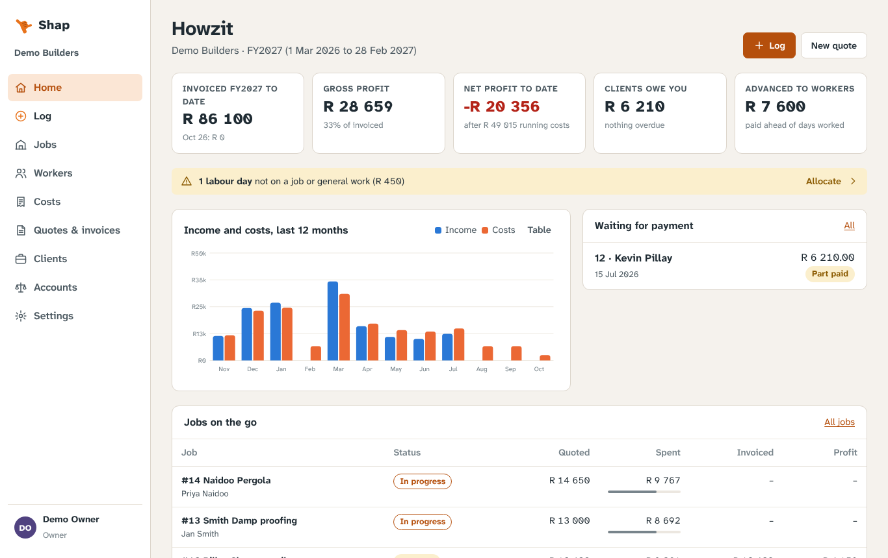
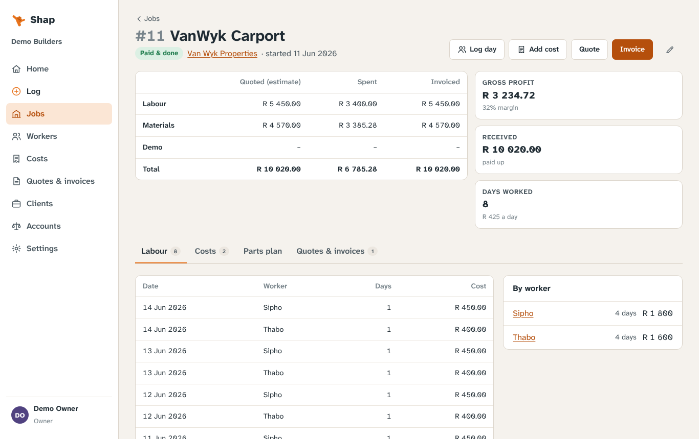
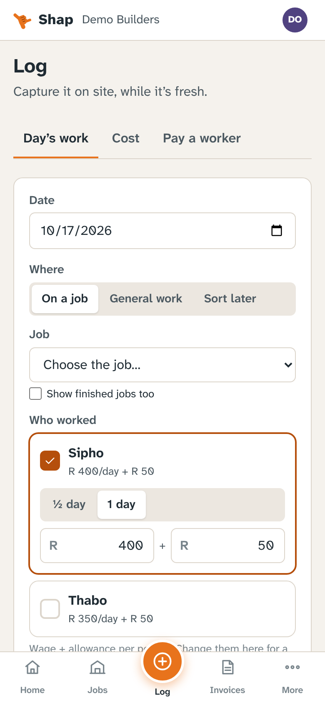
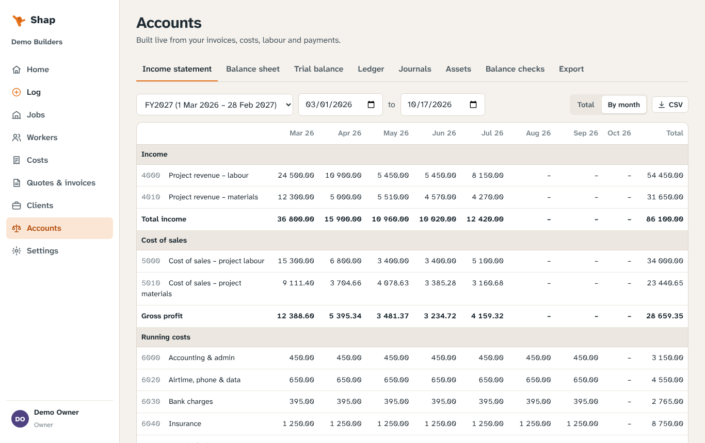
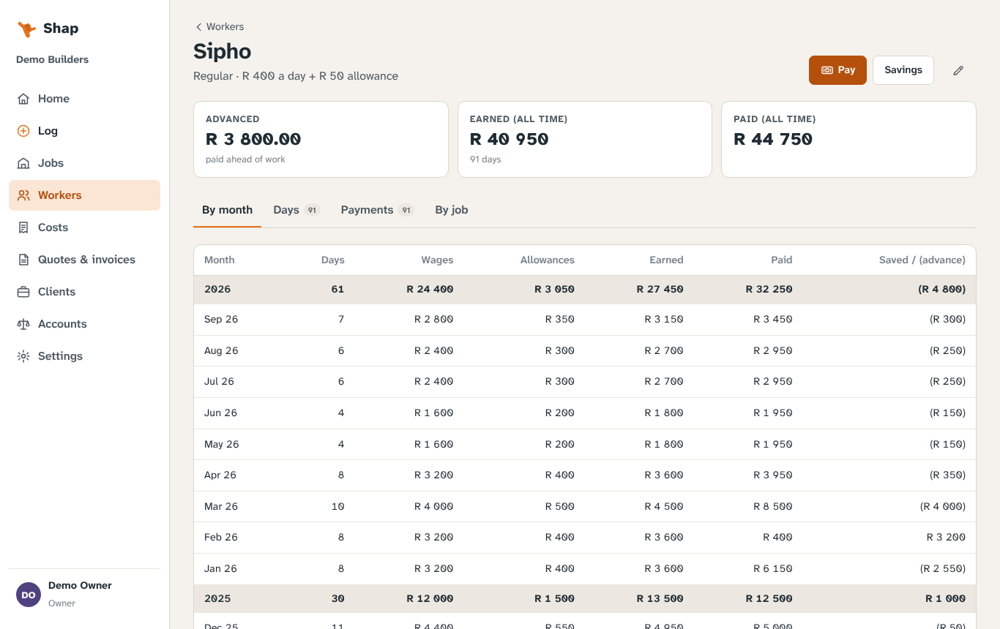
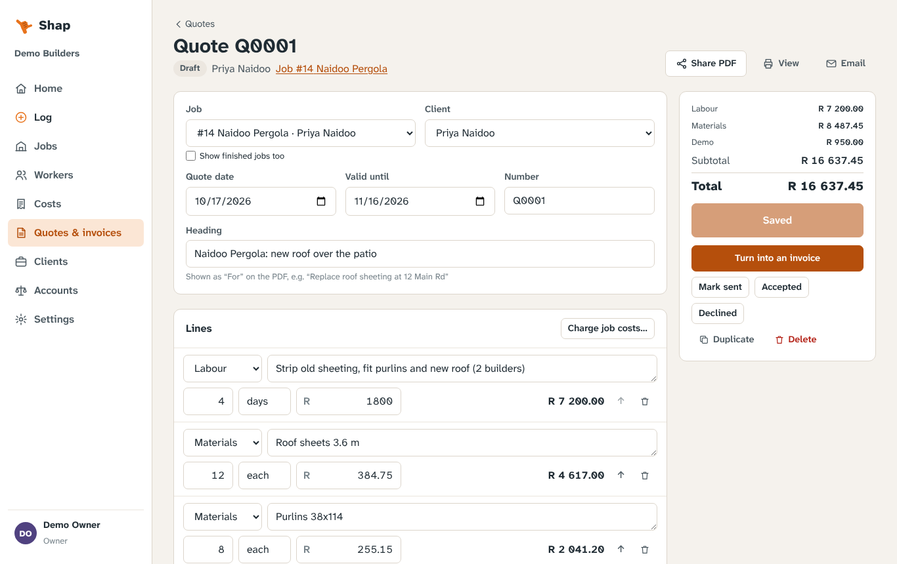
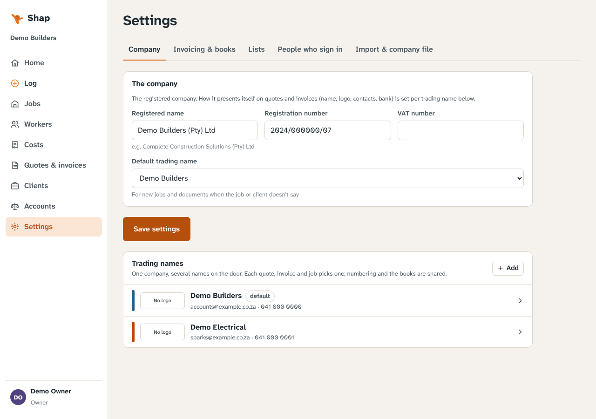
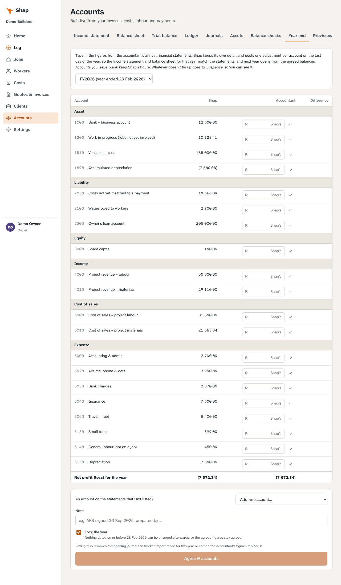
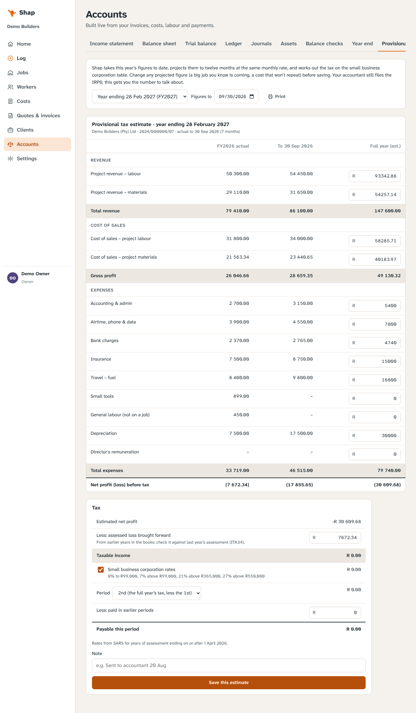

# Shap

**Jobs, labour, quotes, invoices and the books for a small South African contractor.**
Free and open source. It runs on your own VPS, and you open it on your PC or phone.

<br clear="left">

Shap replaces the job spreadsheet + invoicing package combination with one place that knows how
they fit together. When you log a day's work against a job, the job's profit, the worker's pay
and the books all update. Invoice the job, and its costs move into cost of sales in the same month.
The name is the shaka: thumb and pinky out, *shap, all good*.

| Home | A job: quoted, spent, invoiced | Log a crew day on a phone |
|---|---|---|
|  |  |  |
| **Income statement by month** | **A worker's month-by-month** | **Quote from a parts plan** |
|  |  |  |
| **Trading names** | **Agreeing a year to the accountant** | **Provisional tax estimate** |
|  |  |  |

*(Screenshots show the fictional demo company.)*

## What it does

- **Log screen for site.** Log the crew's day in one go: tap the workers, pick the job, or pick a
  type of general work (yard, quoting, fetching stock). If you're not sure, choose *Sort later*.
  Days without a job wait in an **Allocate** list, so labour doesn't fall through the cracks, and
  until they're allocated they count as a running cost. Add a cost with a photo of the slip, or pay
  a worker. It installs to the phone's home screen.
- **Jobs.** Each job shows quoted, spent and invoiced side by side, split into labour, materials
  and demo, with gross profit, margin, what's been received and days worked. Plan the parts a job
  needs, tick them off as you buy them, and turn the plan into a quote with your mark-up.
- **Workers.** Day rate and allowance per worker. Days, wages, allowances, earned, paid and
  saved/(advance) by month and year, plus a per-job breakdown. **Savings** you hold for a worker
  are kept as a memo, separate from the company's money. A *site capture* login logs days at the
  worker's rate without seeing any money.
- **Quotes and invoices.** You can change them at any time, even after sending. Lines are
  labour, materials, demo or other. *Charge job costs* adds what a job has cost and not yet been
  invoiced, plus your mark-up. A quote becomes an invoice in one tap. PDFs can be shared to
  WhatsApp from the phone or emailed. Payments are recorded against invoices, so you see paid,
  part paid and overdue at a glance. VAT can be switched on if you register.
- **Trading names.** One company, several names on the door: each has its own logo, colour,
  contacts and bank details on the PDF. A job, client, quote or invoice goes out under any of
  them; numbering, workflows and the books are shared.
- **Accounts.** Income statement (totals or **by month**, like a Trade Statement), balance sheet,
  trial balance, general ledger per account, journals, an **asset register** with monthly
  depreciation and disposal, **balance checks** against bank, card and loan statements with
  one-tap adjustments, a lock date for closed years, and CSV exports for your accountant. An
  *accountant* login can read and export everything but change nothing.
- **Year end and tax.** Type in the accountant's figures from the annual financial statements and
  Shap posts one adjustment per account, so that year's statements match and the next year opens
  from the agreed balances; whatever doesn't tie up shows in Suspense. A **provisional tax**
  estimate projects this year to twelve months next to last year, with the SARS small business
  corporation table.
- **Import your tracker.** Upload the Excel project tracker (Per Project, Costs, Wages List…) and
  Shap brings across clients, jobs, invoices and payments, costs, workers, days, wage payments and
  savings. It checks every job against *Per Project* and every month against the *Trade Statement*,
  and can agree a closed year to its trial balance. See [docs/importing.md](docs/importing.md).
  Costs with a blank account come in as *not captured yet* rather than guessed, and are ticked
  off in batches later. Client details come across from an Invoice Ninja client export, matched
  to the tracker's client codes with a list you check first.
- **More than one company.** A friend's business can run on the same server with its own
  database, login and address ([deployment](docs/deployment.md#another-company-on-the-same-server)).
  A **company file** carries a whole setup (trading names, logos, clients, agreed year ends)
  from one server to another.

### How the books work

Nothing is double-entered. The general ledger is a **live view** over what you capture:

| You record | The books |
|---|---|
| Invoice issued | Debtors up; revenue by labour / materials / demo; VAT if registered |
| Payment received | Bank (or wherever it went) up; debtors down |
| Cost | Its type's account (fuel, insurance, small tools…), paid from a bank, card, cash or *paid personally* |
| Labour day | Wages owed to the worker; a job cost, or general labour if not on a job |
| Wage payment | Wages owed down; paid from cash, bank or your pocket |
| Asset | On the balance sheet; depreciated monthly; sold or scrapped with profit or loss |
| Journal | Anything else: loan repayments, money you put in, tax |

Job costs (labour, materials, demo) sit in **Work in progress** until the job is invoiced, then
move to cost of sales on the invoice date. Each month then shows a job's income and its costs
together. Cards and accounts in your own name post to your **owner's loan account**, the same
way a director's loan schedule works. Change where a cost type or payment source posts, and every
past entry moves with it.

## Try it on your PC and phone

Run the test stack on any Linux PC with Docker. A Cloudflare tunnel makes it reachable from your
phone, and it runs next to Steady's and Sorted's test stacks:

```bash
git clone https://github.com/OpenWorksIT/shap && cd shap/deploy/test
./start.sh                                  # fictional demo company
./start.sh --import ~/Documents/tracker.xlsx   # or start fresh with your own tracker
./start.sh --import ~/Documents/tracker.xlsx --company ~/Documents/mine.company.json
```

See [deploy/test/README.md](deploy/test/README.md) for a fixed address and the phone home screen.

## Put it on a VPS

[docs/deployment.md](docs/deployment.md): Docker Compose with Postgres, Shap and Caddy (automatic
HTTPS), two-factor sign-in, and nightly encrypted backups.

## Develop

You need Node 22+ and PostgreSQL 15+.

```bash
npm install
createdb shap
npm run db:seed -- --i-know-this-is-demo-data   # or: npm run create-owner -- --email you@x.co.za
npm run dev                                     # API on :8080, web app on :5173
```

Demo logins use the password `demo-shap-1`: `owner@example.co.za`, `site@example.co.za`
(site capture) and `accountant@example.co.za` (read only).

```bash
createdb shap_test
npm test             # API and import tests against Postgres
npm run typecheck
npm run import -- path/to/tracker.xlsx --dry-run   # read a tracker and list what it found
```

### Code layout

```
apps/server     Fastify API (TypeScript), Postgres via postgres.js, SQL migrations
  migrations/002_ledger.sql   the general ledger as a view over the source records
  src/modules/import          tracker reader and importer (exceljs)
  src/modules/pdf.ts          quote and invoice PDFs (pdfkit, Atkinson Hyperlegible)
  src/modules/reports.ts      trial balance, income statement, balance sheet, ledger, journals, assets
apps/web        React + Vite PWA
packages/shared zod schemas, enums, money and date helpers
deploy/vps      main server: Postgres + app + Caddy
deploy/test     PC test stack with a Cloudflare tunnel (like Steady's and Sorted's)
deploy/backup   pg_dump + restic backups (systemd timer)
```

Same foundations as [Sorted](https://github.com/OpenWorksIT/sorted): Fastify, Postgres and a React
PWA, sessions and two-factor sign-in (TOTP with recovery codes, secrets encrypted at rest,
Argon2id passwords), and an append-only audit log.

## Licence

[GNU AGPL-3.0-or-later](LICENSE). If you run a modified version as a service, you share the
changes.

Built by [OpenWorks IT](https://openworks.co.za).
